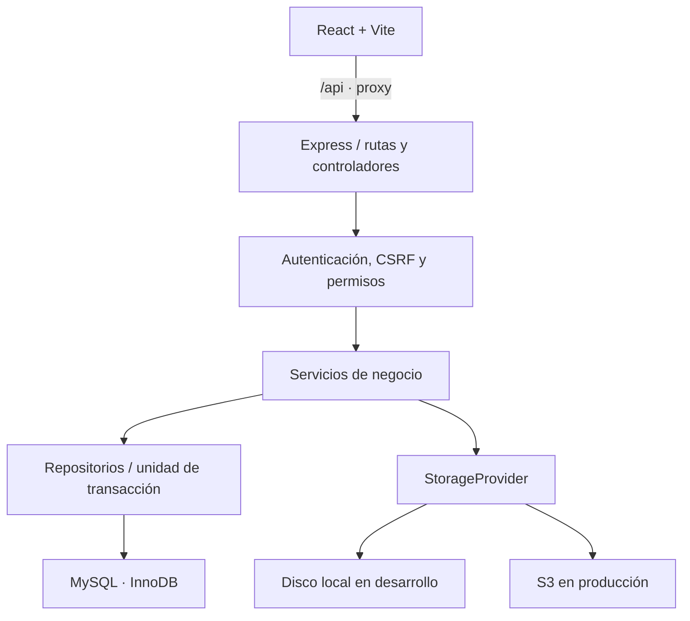

# Arquitectura y reglas de negocio

## Flujo local

La interfaz no decide precios definitivos, permisos ni saldos. Los servicios reciben datos validados y un actor; no reciben `Request` ni `Response`. Las rutas traducen HTTP y sus controladores normalizan las respuestas. Tanto `server.ts` como `lambda.ts` importan `app.ts`, por lo que mantienen una sola lógica de negocio.

El cliente usa fetch con cookies del mismo origen. Vite enruta `/api` a Express durante el desarrollo. En AWS, Nginx enruta `/api` a HTTP API Gateway. El navegador conserva un único origen, evitando cookies de terceros y la necesidad de habilitar CORS.

## Estados

| Entidad | Estado inicial | Transición          | Efecto                                                                |
| ------- | -------------- | ------------------- | --------------------------------------------------------------------- |
| Venta   | draft          | confirm → confirmed | Descuenta las unidades y registra salidas                             |
| Venta   | draft          | cancel → cancelled  | Sin movimiento de existencias                                         |
| Venta   | confirmed      | cancel → cancelled  | Devuelve todas las unidades con movimientos de reversión              |
| Compra  | draft          | receive → received  | Ingresa mercancía y registra entradas                                 |
| Compra  | draft          | cancel → cancelled  | Sin movimiento de existencias                                         |
| Compra  | received       | cancel → cancelled  | Retira todas las unidades recibidas; falla si no hay stock suficiente |

Una operación anulada no se confirma ni se recibe de nuevo. Confirmar/recibir una operación que ya está aplicada, o volver a anularla, retorna su estado actual sin repetir movimientos. No se editan las líneas de un borrador: se anula y se crea otro. Esto conserva el rastro de precios y cantidades.

No hay recepción parcial, reserva de existencias para borradores, ventas a crédito, pago electrónico ni devoluciones parciales. Los borradores compiten por las existencias cuando se confirman. Una anulación de compra se trata como una reversión administrativa; no pretende modelar un proceso físico de devolución a proveedores.

## Dinero

- MySQL guarda precios, subtotales y totales con `DECIMAL(18,2)`.
- La API recibe importes como strings: `"45000.00"`. La validación admite máximo 12 dígitos enteros para un precio y dos decimales.
- Los cálculos usan Decimal.js con precisión 32; no usan `parseFloat` ni multiplicaciones con `number` para determinar importes.
- Se calculan subtotales de línea y luego la suma. El resultado también se entrega como string.
- Las cantidades son enteros entre 1 y 1.000.000 por línea; el saldo total queda limitado por el INT firmado de inventario.
- El frontend utiliza Decimal.js en la vista previa y convierte a Number únicamente para representación con Intl y gráficos. El servidor siempre recalcula.
- Una venta usa el precio de venta vigente al crear el borrador; el nombre y precio quedan copiados en su detalle. Una compra admite su precio negociado. Recibir una compra no sustituye automáticamente el precio del catálogo ni calcula costo promedio.

## Transacciones y concurrencia

Al confirmar, recibir o anular, se bloquea primero la cabecera con `FOR UPDATE`. Las líneas se procesan por ID de producto ascendente. El movimiento bloquea inventario y producto; calcula el siguiente saldo, valida que no sea negativo, actualiza el inventario e inserta el movimiento dentro de la misma transacción. Las notificaciones y la auditoría exitosa se insertan en esa misma transacción.

La cabecera serializa dos solicitudes para la misma operación. La unicidad de `(producto, tipo de origen, id de origen, clase de movimiento)` añade protección frente a movimientos duplicados. No se confía en deshabilitar un botón para evitar repeticiones. Un fallo en la segunda línea revierte cabecera, líneas de movimiento, saldos y alertas de la operación completa.

La creación exige `request_key` UUID y conserva un hash del contenido y el autor. Repetir exactamente la solicitud devuelve el borrador original. Reutilizar la clave con otro contenido o autor produce 409. Si dos creaciones iguales llegan a la vez antes de que exista la cabecera, la restricción UNIQUE puede devolver 409 a una; reintentar con la misma clave recupera la operación creada.

Un deadlock o tiempo de espera de MySQL se traduce a 409. El cliente puede recargar y reintentar; no se reejecuta una modificación sin conocer su resultado. Las pruebas incluyen competencia por una unidad y rollback de una venta con varias líneas.

## Catálogos y archivos

Un producto nuevo obtiene una fila de inventario con saldo cero dentro de su transacción de creación. El stock no se edita desde el formulario del producto. Los saldos iniciales, correcciones, compras y ventas generan movimientos.

Se exige un producto y un tercero activos para crear y aplicar una operación. La reversión sigue disponible aunque un producto haya sido desactivado. Desactivar una categoría no borra productos ni transacciones existentes.

Los archivos se guardan bajo una clave UUID, separada del nombre original. `StorageProvider` concentra put/get/delete/ready y una URL temporal opcional. Los servicios de documentos validan asociaciones y permisos; el proveedor no decide autorización. Un objeto que falle al eliminarse después de borrar metadatos queda inaccesible desde la API; se revisa con una tarea de conciliación antes de adoptar limpieza automática. Ver política en SEGURIDAD.md.

## Límites de escala

La API no mantiene sesiones ni notificaciones en memoria. Cada instancia o ejecución Lambda consulta MySQL. Solo existe un límite de login en memoria como barrera adicional; el control por identidad está persistido en la base. Las conexiones usan un pool pequeño de cinco por proceso; en AWS se propone RDS Proxy y concurrencia Lambda limitada.

Los reportes sincrónicos tienen un máximo de 10.000 filas. En Lambda/API Gateway hay que respetar el límite de carga útil: para exportaciones que lo superen se requiere un trabajo de exportación con resultado en S3 y descarga prefirmada. Esa extensión no se presenta como implementada en esta entrega.

No hay workers ni temporizadores persistentes en el backend de negocio. La limpieza de sesiones, tokens usados e intentos expirados debe ser una tarea externa programada en una fase de operación. El proceso Express solo tiene el cierre controlado de conexiones; Lambda exporta el handler sin iniciar un listener.

## Nombres físicos en español

Las 22 tablas de negocio usan nombres españoles. El historial técnico se llama `migraciones_esquema`. `backend/src/models/table-names.ts` relaciona las entidades lógicas con los nombres físicos: por ejemplo, la ruta `/api/products` y la entidad lógica `products` acceden a `productos`. El mapa solo permite nombres definidos por el proyecto; los valores de datos continúan parametrizados.

Se conservan columnas (`name`, `product_id`, etc.), estados y discriminadores de documentos/movimientos (`products`, `sales`, `purchases`) para mantener compatibilidad con registros y clientes existentes. Esos valores no son nombres físicos de tablas. Las columnas y el código no se traducen íntegramente en esta actualización.

`001_initial.sql` queda intacta. La nueva migración 002 ejecuta un único `RENAME TABLE` para las 21 tablas cuyo nombre cambia; `roles` ya está en español. El ejecutor conserva y renombra el historial técnico anterior. Una base nueva aplica ambas migraciones y termina con los mismos nombres finales.
