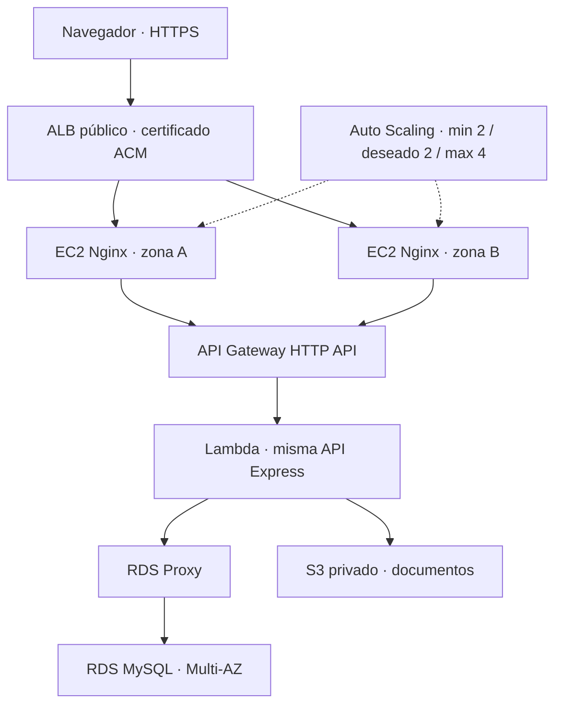

# Preparación para AWS — fase posterior

**No se han creado recursos AWS.** Las plantillas y el adaptador forman una base de despliegue que debe validarse con los parámetros de la cuenta. No se afirma que el balanceo, la alta disponibilidad o el autoescalamiento ya estén funcionando.

## Diseño previsto



Las instancias EC2 sirven únicamente archivos del frontend compilado y el proxy HTTP. La base, las sesiones, las notificaciones, la auditoría y los documentos no residen en sus discos. El contenido estático del release puede reemplazarse en cualquier instancia sin pérdida de datos de negocio.

Lambda importa la misma aplicación Express mediante `@codegenie/serverless-express`, sin listener. La imagen usa Node 24 y se instala en una base de Amazon Linux para conservar compatibilidad con Argon2 nativo. La API no mantiene estado de usuario en memoria. RDS Multi-AZ y RDS Proxy se plantean como dependencias administradas, junto con S3 privado.

## Archivos de infraestructura

| Archivo             | Contenido y alcance                                                                                                                                 |
| ------------------- | --------------------------------------------------------------------------------------------------------------------------------------------------- |
| `frontend.yaml`     | ALB HTTPS, redirect HTTP, target group, grupos de seguridad, rol EC2 de lectura del release, Launch Template, ASG y política de requests por target |
| `nginx.conf`        | SPA, endpoint de salud estático, proxy `/api` con TLS verificado y cabecera de identificación de instancia                                          |
| `backend-sam.yaml`  | HTTP API, Lambda de contenedor, bucket privado cifrado/versionado y parámetros para red/RDS Proxy                                                   |
| `Dockerfile.lambda` | Construcción de TypeScript y dependencias nativas dentro de la imagen Lambda Node 24                                                                |
| `tests/load.js`     | Prueba k6 futura y controlada del frontend y del encabezado de instancia                                                                            |

No incluyen la creación de VPC, subredes, DNS, certificado ACM, RDS ni RDS Proxy. Esas dependencias deben provisionarse antes de las plantillas. No se utiliza SNS para las notificaciones internas.

## Dependencias y parámetros que hay que resolver

1. VPC con al menos dos zonas de disponibilidad. Dos subredes públicas distintas para el ALB y las instancias del ejemplo; rutas a internet y DNS habilitados. El Launch Template asigna una IP pública para que Nginx pueda descargar el release y acceder a API Gateway; su grupo de seguridad solo acepta HTTP desde el ALB. Para un entorno más restringido, coloca las EC2 en subredes privadas y adapta las rutas NAT/VPC endpoints y el Launch Template.
2. Dos subredes privadas distintas para Lambda, RDS y Proxy. RDS no debe ser públicamente accesible. El grupo del Proxy acepta 3306 solo desde el de Lambda; el de RDS solo desde el del Proxy. Lambda requiere una ruta privada a S3 mediante endpoint o salida correspondiente. El bucket necesita permitir acceso desde el rol de Lambda.
3. RDS MySQL 8.4 con Multi-AZ, cifrado, respaldos automáticos, protección contra borrado y parámetros en UTC. Crea un usuario de migraciones y otro de aplicación. El usuario de aplicación no necesita DDL ni permisos globales. Ejecuta migraciones una sola vez desde una máquina autorizada en la red, antes de dar tráfico.
4. RDS Proxy asociado a RDS, secret de credenciales e IAM/seguridad requeridos. El `DATABASE_URL` apunta al proxy, no al endpoint público de RDS. `DATABASE_TLS=true` verifica certificados; configura `DATABASE_CA_BASE64` si la CA del endpoint no pertenece al almacén de confianza de Node.
5. Dominio del frontend, certificado ACM emitido en la región del ALB y registro DNS alias al ALB. `APP_ORIGIN` debe ser el origen HTTPS exacto, sin ruta ni slash final.
6. Bucket privado de releases, separado del bucket de documentos. Credenciales locales para el despliegue mediante el método que establezca la cuenta; no se incluyen claves en el repositorio.

El número de conexiones potenciales es `5 × concurrencia Lambda`. La plantilla limita inicialmente la concurrencia a 10; verifica capacidad de RDS y comportamiento de Proxy antes de aumentarla. La afinidad causada por transacciones y el número de conexiones reales se miden con CloudWatch.

## Preparación del release

Desde la raíz, después de las pruebas:

```bash
npm ci
npm run build
```

Crea un tar.gz cuyo contenido raíz sea `frontend/dist/*` más `infrastructure/nginx.conf` con el nombre `nginx.conf`. Ejemplo en una terminal con tar:

```bash
node scripts/package-web.mjs
```

Se genera `build/sige-web.tar.gz`. Sube ese archivo al bucket privado de releases con un `ArtifactKey` inmutable por versión, por ejemplo `releases/2026-10-27/sige-web.tar.gz`. Las EC2 lo descargan con su rol, sin credenciales persistentes. `ArtifactBucket`, `ArtifactKey` y `ApiHost` son parámetros del stack frontend. El hostname de API Gateway se utiliza sin `https://` y con stage `$default`; Nginx conserva la ruta `/api/...`.

La plantilla reemplaza el servidor default de Nginx y activa su servicio. La actualización de `ArtifactKey` crea una versión nueva del Launch Template y permite el reemplazo gradual de instancias. Conserva releases anteriores para rollback. Las plantillas se revisan primero con herramientas de validación y mediante un change set; estos pasos no se ejecutaron en una cuenta AWS.

Para SAM se requiere Docker y AWS SAM CLI. Desde `infrastructure`:

```bash
sam validate --lint -t backend-sam.yaml
sam build -t backend-sam.yaml
```

El despliegue posterior debe proporcionar subredes, grupos, origen y credenciales seguras. El parámetro NoEcho para la URL no sustituye a un gestor de secretos. Puede usarse una referencia dinámica a Secrets Manager durante el aprovisionamiento; la aplicación recibe el valor resuelto en su entorno. Esa modalidad exige actualizar/republicar la configuración cuando cambie la contraseña. Una consulta del secret en ejecución con caché es una extensión operativa pendiente si se necesita rotación sin redespliegue.

## Salud, balanceo y escalamiento

| Ruta o mecanismo      | Propósito                                                                                                |
| --------------------- | -------------------------------------------------------------------------------------------------------- |
| Nginx `GET /health`   | Comprueba la instancia frontend; responde 200 sin depender de la API                                     |
| API `GET /api/health` | Liveness del proceso/adaptador; no consulta dependencias                                                 |
| API `GET /api/ready`  | Comprueba MySQL y almacenamiento; devuelve 503 si no están disponibles                                   |
| Target group          | Health check `/health` cada 15 s, dos éxitos para sano, tres fallos para no sano                         |
| ASG                   | HealthCheckType ELB, gracia 180 s y warmup 180 s; reemplaza instancias no sanas                          |
| Capacidad             | Mínimo 2, deseado 2 y máximo 4 por defecto, ajustables de forma coherente                                |
| Política              | Target tracking `ALBRequestCountPerTarget`, objetivo inicial 600 requests por target y minuto, ajustable |

La elección de requests por target refleja la función de EC2: servir archivos y hacer proxy. Una prueba de esta capa puede no llevar su CPU a un umbral alto, por lo que no se usa CPU como única señal. El escalamiento de Lambda es independiente del ASG.

No se usa `/api/ready` como health check del grupo EC2: una caída global de RDS no se resolvería sustituyendo todas las instancias frontend. Se requieren alarmas independientes para ready, errores/latencia de API Gateway, Lambda, RDS y S3.

`X-SIGE-Instance` permite observar distintos hosts en respuestas del frontend. No prueba por sí mismo el crecimiento del ASG; solo ayuda a comprobar reparto de tráfico. Se puede retirar después de la evaluación.

## Validación futura exigida

1. Confirma dos targets sanos en zonas diferentes y estado `InService` de las instancias. Guarda fecha, stack, versión del release, target group y capturas de consola necesarias para la evaluación.
2. Solicita `/` varias veces desde conexiones distintas y registra `X-SIGE-Instance`. Deshabilita caché y confirma al menos dos identificadores. Comprueba login, cookies Secure, CSRF, subida/descarga S3 y las transacciones con la misma batería de aceptación.
3. Ejecuta k6 **solo contra el entorno propio de prueba**:

   ```bash
   k6 run -e BASE_URL=https://TU_DOMINIO tests/load.js
   ```

4. Mientras corre, observa `RequestCountPerTarget`, la política, actividades de Auto Scaling, desired capacity y targets. Ajusta el objetivo o la carga a un nivel controlado si no se supera el umbral; la carga de ejemplo no garantiza una ampliación.
5. Para aprobar autoescalamiento, conserva evidencia de pasar de 2 a 3/4 instancias sanas y de volver a 2 después del enfriamiento. Registra latencias, errores y tiempos; no concluyas éxito solo porque k6 no falló.
6. En una prueba separada y autorizada, detén Nginx en una instancia de pruebas. Comprueba que el ALB la marca no sana, el ASG la reemplaza y el servicio permanece accesible. Registra el tiempo de recuperación y los errores observados.
7. Prueba la recuperación de RDS Multi-AZ y la restauración de respaldos con un procedimiento específico. La configuración Multi-AZ no sustituye una copia de seguridad ni demuestra por sí sola continuidad de cada transacción.

La carga puede generar costos. Define previamente el tiempo máximo, límite de instancias, presupuesto y criterios de parada. No se ejecutó carga ni se incurrió en recursos AWS en esta entrega.

## Límite de archivos y reportes en Lambda

La API local admite archivos de hasta 5 MiB. Una petición binaria que API Gateway entregue a Lambda como base64 aumenta de tamaño y puede alcanzar antes el límite de invocación. Antes de abrir las cargas en AWS, verifica los límites vigentes y usa un máximo menor medido o completa el flujo de subida directa a S3 descrito en SEGURIDAD.md. No basta con mantener 5 MiB en Multer para prometer ese tamaño en producción.

Del mismo modo, los reportes que excedan la respuesta admitida deben generarse en S3 y descargarse mediante URL temporal. El sistema actual genera reportes de forma sincrónica y limita filas, no bytes. Estas comprobaciones son pendientes de despliegue.

## Referencias oficiales consultadas

- [Node.js LTS y ciclo de versiones](https://github.com/nodejs/Release).
- [Runtime Node.js de Lambda](https://docs.aws.amazon.com/lambda/latest/dg/lambda-nodejs.html).
- [Target tracking en EC2 Auto Scaling](https://docs.aws.amazon.com/autoscaling/ec2/userguide/as-scaling-target-tracking.html).
- [CloudFormation ScalingPolicy](https://docs.aws.amazon.com/AWSCloudFormation/latest/TemplateReference/aws-resource-autoscaling-scalingpolicy.html).
- [Bloqueos de lectura InnoDB](https://dev.mysql.com/doc/refman/8.4/en/innodb-locking-reads.html).

Los identificadores, parámetros, cuotas y versiones se deben volver a verificar al iniciar el despliegue real.
