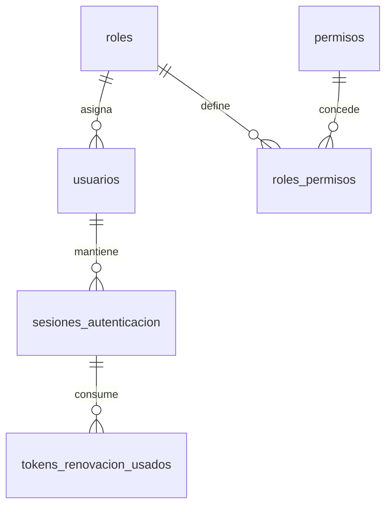
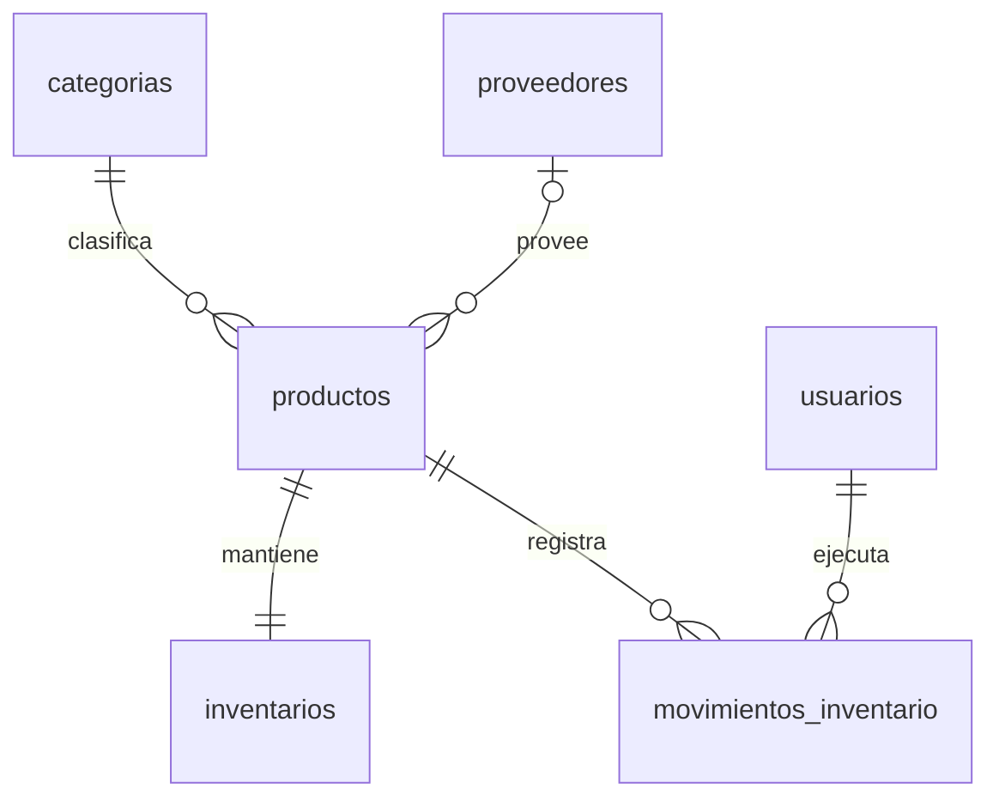
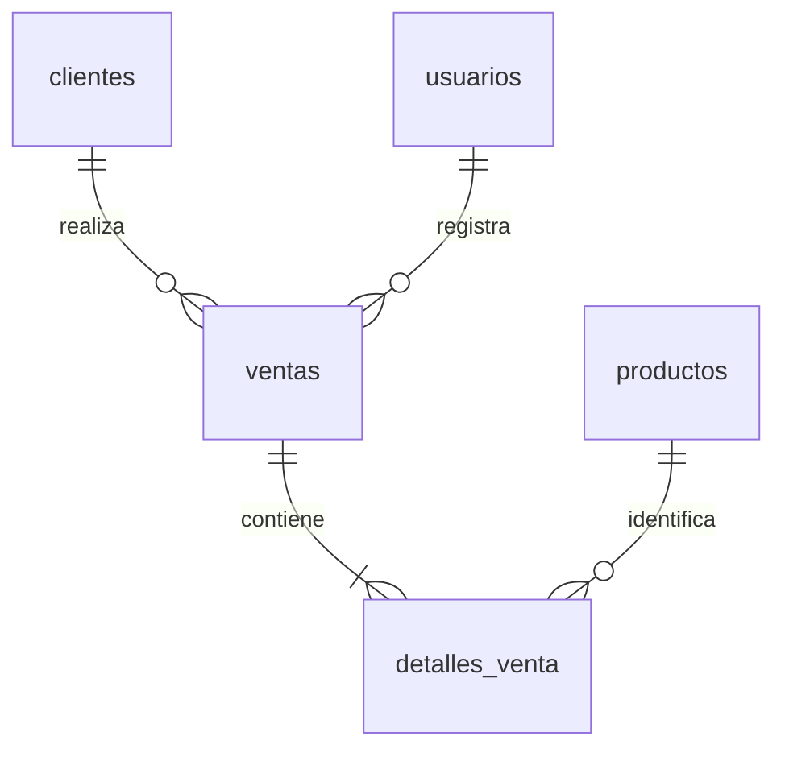
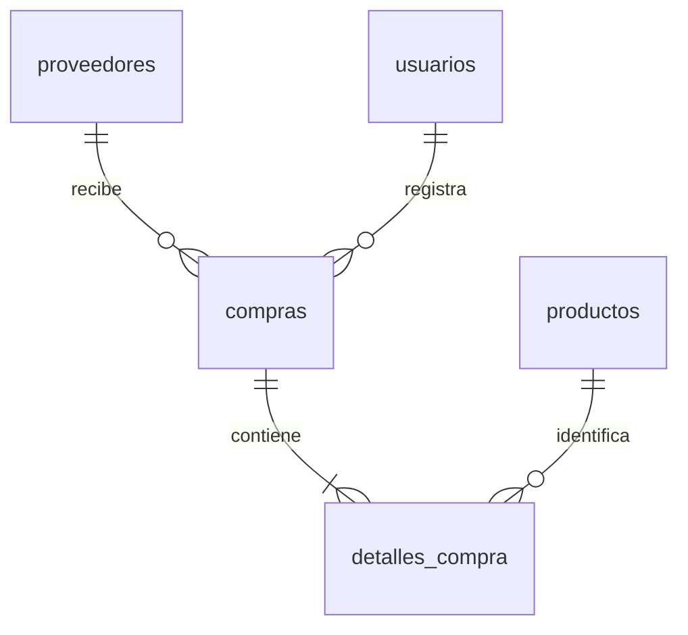
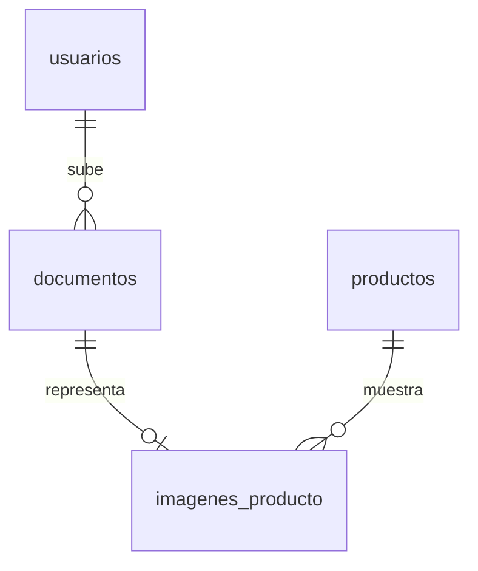
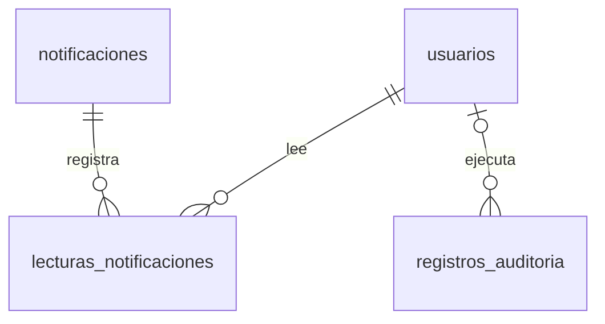

# Modelo de datos y diccionario

El esquema contiene 22 tablas, además del registro técnico `migraciones_esquema`. El DDL final de referencia está en `database/esquema_actual_espanol.sql`. La instalación y actualización se ejecutan con `npm run db:migrate`, que aplica `001_initial.sql` y `002_tablas_en_espanol.sql` en orden. La primera migración se conserva en su versión original en inglés para mantener su checksum histórico. `database/modelo.dbml` incluye todas las tablas y claves foráneas para visualizar el modelo con herramientas DBML. Los diagramas siguientes dividen el modelo por función para facilitar la lectura; las tablas compartidas conservan la misma identidad.

## Acceso

`intentos_inicio_sesion` conserva identidades hasheadas para limitar intentos sin revelar correos. No necesita FK a usuarios, porque también registra intentos contra cuentas inexistentes.

## Catálogo e inventario

El proveedor principal del producto es opcional. Además se pueden consultar productos adquiridos históricamente a un proveedor a través de compras y sus detalles. Cada producto tiene exactamente una fila de inventario, creada por el servicio del catálogo. La FK por sí sola no obliga a que exista esa fila; la transacción de creación cumple esa regla.

## Ventas y compras

Cada detalle guarda nombre, cantidad, precio y subtotal históricos. No se borran terceros ni productos físicamente. Los movimientos identifican origen (`ventas`, `compras` o `adjustment`) e ID. Esa asociación polimórfica no tiene una FK a dos tablas; el servicio valida su origen y la transacción asegura su consistencia.

## Archivos, avisos y auditoría

`documentos.entity_type/entity_id` permite asociar documentos con productos, clientes, proveedores, ventas o compras. Se valida la entidad en el servicio; no es una FK polimórfica nativa. `imagenes_producto` sí aplica FK explícita y se elimina en cascada cuando se elimina su documento. El inventario usa alertas compartidas y cada usuario conserva su propia lectura.

## Integridad y conservación

- Motor InnoDB, esquema utf8mb4 y reloj de conexión UTC.
- IDs numéricos internos; UUID para sesiones y claves idempotentes.
- Precios y totales DECIMAL(18,2), stock no negativo y cantidades positivas en detalles.
- UNIQUE en correo, identificación, código y clave idempotente; no se reutilizan tras desactivar.
- UNIQUE por producto dentro de una operación y por movimiento de una transición.
- Estados limitados mediante CHECK; las transiciones permitidas las controla el servicio.
- Índices para búsquedas, fechas, terceros, asociaciones y sesiones.
- Lecturas de inventario y cabeceras bloqueadas al aplicar transacciones.
- Metadatos de migración con checksum y bloqueo MySQL GET_LOCK para evitar dos migradores simultáneos. El DDL MySQL no es transaccional como una venta; el despliegue de esquema exige respaldo y recuperación ante fallo.

## Diccionario de tablas

### `roles`

| Columna | Tipo          | Reglas SQL                          |
| ------- | ------------- | ----------------------------------- |
| `id`    | `int`         | UNSIGNED AUTO_INCREMENT PRIMARY KEY |
| `name`  | `varchar(40)` | NOT NULL UNIQUE                     |

Restricciones e índices: .

### `permisos`

| Columna | Tipo          | Reglas SQL                          |
| ------- | ------------- | ----------------------------------- |
| `id`    | `int`         | UNSIGNED AUTO_INCREMENT PRIMARY KEY |
| `name`  | `varchar(80)` | NOT NULL UNIQUE                     |

Restricciones e índices: .

### `roles_permisos`

| Columna         | Tipo  | Reglas SQL        |
| --------------- | ----- | ----------------- |
| `role_id`       | `int` | UNSIGNED NOT NULL |
| `permission_id` | `int` | UNSIGNED NOT NULL |

Restricciones e índices: `PRIMARY KEY(role_id,permission_id)`; `FOREIGN KEY(role_id) REFERENCES roles(id)`; `FOREIGN KEY(permission_id) REFERENCES permisos(id)`.

### `usuarios`

| Columna         | Tipo           | Reglas SQL                                                     |
| --------------- | -------------- | -------------------------------------------------------------- |
| `id`            | `int`          | UNSIGNED AUTO_INCREMENT PRIMARY KEY                            |
| `name`          | `varchar(120)` | NOT NULL                                                       |
| `email`         | `varchar(190)` | NOT NULL UNIQUE                                                |
| `password_hash` | `varchar(255)` | NOT NULL                                                       |
| `role_id`       | `int`          | UNSIGNED NOT NULL                                              |
| `status`        | `varchar(16)`  | NOT NULL DEFAULT 'active'                                      |
| `created_at`    | `datetime`     | NOT NULL DEFAULT CURRENT_TIMESTAMP                             |
| `updated_at`    | `datetime`     | NOT NULL DEFAULT CURRENT_TIMESTAMP ON UPDATE CURRENT_TIMESTAMP |

Restricciones e índices: `FOREIGN KEY(role_id) REFERENCES roles(id)`; `CHECK(status IN ('active','inactive'))`.

### `sesiones_autenticacion`

| Columna             | Tipo       | Reglas SQL                         |
| ------------------- | ---------- | ---------------------------------- |
| `id`                | `char(36)` | PRIMARY KEY                        |
| `user_id`           | `int`      | UNSIGNED NOT NULL                  |
| `access_hash`       | `char(64)` | NOT NULL UNIQUE                    |
| `refresh_hash`      | `char(64)` | NOT NULL UNIQUE                    |
| `csrf_hash`         | `char(64)` | NOT NULL                           |
| `access_expires_at` | `datetime` | NOT NULL                           |
| `expires_at`        | `datetime` | NOT NULL                           |
| `revoked_at`        | `datetime` | NULL                               |
| `created_at`        | `datetime` | NOT NULL DEFAULT CURRENT_TIMESTAMP |

Restricciones e índices: `FOREIGN KEY(user_id) REFERENCES usuarios(id)`; `INDEX(user_id,expires_at)`.

### `tokens_renovacion_usados`

| Columna      | Tipo       | Reglas SQL  |
| ------------ | ---------- | ----------- |
| `token_hash` | `char(64)` | PRIMARY KEY |
| `session_id` | `char(36)` | NOT NULL    |
| `expires_at` | `datetime` | NOT NULL    |

Restricciones e índices: `FOREIGN KEY(session_id) REFERENCES sesiones_autenticacion(id)`.

### `intentos_inicio_sesion`

| Columna         | Tipo       | Reglas SQL                          |
| --------------- | ---------- | ----------------------------------- |
| `id`            | `bigint`   | UNSIGNED AUTO_INCREMENT PRIMARY KEY |
| `identity_hash` | `char(64)` | NOT NULL                            |
| `created_at`    | `datetime` | NOT NULL DEFAULT CURRENT_TIMESTAMP  |

Restricciones e índices: `INDEX(identity_hash,created_at)`.

### `categorias`

| Columna       | Tipo            | Reglas SQL                                                     |
| ------------- | --------------- | -------------------------------------------------------------- |
| `id`          | `int`           | UNSIGNED AUTO_INCREMENT PRIMARY KEY                            |
| `name`        | `varchar(120)`  | NOT NULL UNIQUE                                                |
| `description` | `varchar(1000)` | NOT NULL DEFAULT ''                                            |
| `status`      | `varchar(16)`   | NOT NULL DEFAULT 'active'                                      |
| `created_at`  | `datetime`      | NOT NULL DEFAULT CURRENT_TIMESTAMP                             |
| `updated_at`  | `datetime`      | NOT NULL DEFAULT CURRENT_TIMESTAMP ON UPDATE CURRENT_TIMESTAMP |

Restricciones e índices: `CHECK(status IN ('active','inactive'))`.

### `clientes`

| Columna          | Tipo           | Reglas SQL                                                     |
| ---------------- | -------------- | -------------------------------------------------------------- |
| `id`             | `int`          | UNSIGNED AUTO_INCREMENT PRIMARY KEY                            |
| `identification` | `varchar(40)`  | NOT NULL UNIQUE                                                |
| `name`           | `varchar(120)` | NOT NULL                                                       |
| `phone`          | `varchar(40)`  | NOT NULL DEFAULT ''                                            |
| `email`          | `varchar(190)` | NOT NULL DEFAULT ''                                            |
| `address`        | `varchar(300)` | NOT NULL DEFAULT ''                                            |
| `status`         | `varchar(16)`  | NOT NULL DEFAULT 'active'                                      |
| `created_at`     | `datetime`     | NOT NULL DEFAULT CURRENT_TIMESTAMP                             |
| `updated_at`     | `datetime`     | NOT NULL DEFAULT CURRENT_TIMESTAMP ON UPDATE CURRENT_TIMESTAMP |

Restricciones e índices: `CHECK(status IN ('active','inactive'))`.

### `proveedores`

| Columna          | Tipo           | Reglas SQL                                                     |
| ---------------- | -------------- | -------------------------------------------------------------- |
| `id`             | `int`          | UNSIGNED AUTO_INCREMENT PRIMARY KEY                            |
| `identification` | `varchar(40)`  | NOT NULL UNIQUE                                                |
| `name`           | `varchar(120)` | NOT NULL                                                       |
| `phone`          | `varchar(40)`  | NOT NULL DEFAULT ''                                            |
| `email`          | `varchar(190)` | NOT NULL DEFAULT ''                                            |
| `address`        | `varchar(300)` | NOT NULL DEFAULT ''                                            |
| `status`         | `varchar(16)`  | NOT NULL DEFAULT 'active'                                      |
| `created_at`     | `datetime`     | NOT NULL DEFAULT CURRENT_TIMESTAMP                             |
| `updated_at`     | `datetime`     | NOT NULL DEFAULT CURRENT_TIMESTAMP ON UPDATE CURRENT_TIMESTAMP |

Restricciones e índices: `CHECK(status IN ('active','inactive'))`.

### `productos`

| Columna          | Tipo            | Reglas SQL                                                     |
| ---------------- | --------------- | -------------------------------------------------------------- |
| `id`             | `int`           | UNSIGNED AUTO_INCREMENT PRIMARY KEY                            |
| `code`           | `varchar(40)`   | NOT NULL UNIQUE                                                |
| `name`           | `varchar(140)`  | NOT NULL                                                       |
| `description`    | `varchar(1000)` | NOT NULL DEFAULT ''                                            |
| `category_id`    | `int`           | UNSIGNED NOT NULL                                              |
| `supplier_id`    | `int`           | UNSIGNED NULL                                                  |
| `purchase_price` | `decimal(18,2)` | NOT NULL                                                       |
| `sale_price`     | `decimal(18,2)` | NOT NULL                                                       |
| `min_stock`      | `int`           | UNSIGNED NOT NULL DEFAULT 5                                    |
| `status`         | `varchar(16)`   | NOT NULL DEFAULT 'active'                                      |
| `created_at`     | `datetime`      | NOT NULL DEFAULT CURRENT_TIMESTAMP                             |
| `updated_at`     | `datetime`      | NOT NULL DEFAULT CURRENT_TIMESTAMP ON UPDATE CURRENT_TIMESTAMP |

Restricciones e índices: `FOREIGN KEY(category_id) REFERENCES categorias(id)`; `FOREIGN KEY(supplier_id) REFERENCES proveedores(id)`; `CHECK(purchase_price>=0)`; `CHECK(sale_price>=0)`; `CHECK(status IN ('active','inactive'))`; `INDEX(category_id,status)`; `INDEX(name)`.

### `inventarios`

| Columna      | Tipo       | Reglas SQL                                                     |
| ------------ | ---------- | -------------------------------------------------------------- |
| `product_id` | `int`      | UNSIGNED PRIMARY KEY                                           |
| `stock`      | `int`      | NOT NULL DEFAULT 0                                             |
| `updated_at` | `datetime` | NOT NULL DEFAULT CURRENT_TIMESTAMP ON UPDATE CURRENT_TIMESTAMP |

Restricciones e índices: `FOREIGN KEY(product_id) REFERENCES productos(id)`; `CHECK(stock>=0)`.

### `ventas`

| Columna         | Tipo            | Reglas SQL                                                     |
| --------------- | --------------- | -------------------------------------------------------------- |
| `id`            | `int`           | UNSIGNED AUTO_INCREMENT PRIMARY KEY                            |
| `customer_id`   | `int`           | UNSIGNED NOT NULL                                              |
| `user_id`       | `int`           | UNSIGNED NOT NULL                                              |
| `status`        | `varchar(16)`   | NOT NULL DEFAULT 'draft'                                       |
| `total`         | `decimal(18,2)` | NOT NULL                                                       |
| `request_key`   | `char(36)`      | NOT NULL UNIQUE                                                |
| `request_hash`  | `char(64)`      | NOT NULL                                                       |
| `cancel_reason` | `varchar(500)`  | NULL                                                           |
| `created_at`    | `datetime`      | NOT NULL DEFAULT CURRENT_TIMESTAMP                             |
| `updated_at`    | `datetime`      | NOT NULL DEFAULT CURRENT_TIMESTAMP ON UPDATE CURRENT_TIMESTAMP |

Restricciones e índices: `FOREIGN KEY(customer_id) REFERENCES clientes(id)`; `FOREIGN KEY(user_id) REFERENCES usuarios(id)`; `CHECK(total>=0)`; `CHECK(status IN ('draft','confirmed','cancelled'))`; `INDEX(status,created_at)`; `INDEX(customer_id,created_at)`.

### `compras`

| Columna         | Tipo            | Reglas SQL                                                     |
| --------------- | --------------- | -------------------------------------------------------------- |
| `id`            | `int`           | UNSIGNED AUTO_INCREMENT PRIMARY KEY                            |
| `supplier_id`   | `int`           | UNSIGNED NOT NULL                                              |
| `user_id`       | `int`           | UNSIGNED NOT NULL                                              |
| `status`        | `varchar(16)`   | NOT NULL DEFAULT 'draft'                                       |
| `total`         | `decimal(18,2)` | NOT NULL                                                       |
| `request_key`   | `char(36)`      | NOT NULL UNIQUE                                                |
| `request_hash`  | `char(64)`      | NOT NULL                                                       |
| `cancel_reason` | `varchar(500)`  | NULL                                                           |
| `created_at`    | `datetime`      | NOT NULL DEFAULT CURRENT_TIMESTAMP                             |
| `updated_at`    | `datetime`      | NOT NULL DEFAULT CURRENT_TIMESTAMP ON UPDATE CURRENT_TIMESTAMP |

Restricciones e índices: `FOREIGN KEY(supplier_id) REFERENCES proveedores(id)`; `FOREIGN KEY(user_id) REFERENCES usuarios(id)`; `CHECK(total>=0)`; `CHECK(status IN ('draft','received','cancelled'))`; `INDEX(status,created_at)`; `INDEX(supplier_id,created_at)`.

### `detalles_venta`

| Columna        | Tipo            | Reglas SQL                          |
| -------------- | --------------- | ----------------------------------- |
| `id`           | `int`           | UNSIGNED AUTO_INCREMENT PRIMARY KEY |
| `sale_id`      | `int`           | UNSIGNED NOT NULL                   |
| `product_id`   | `int`           | UNSIGNED NOT NULL                   |
| `product_name` | `varchar(140)`  | NOT NULL                            |
| `quantity`     | `int`           | UNSIGNED NOT NULL                   |
| `unit_price`   | `decimal(18,2)` | NOT NULL                            |
| `subtotal`     | `decimal(18,2)` | NOT NULL                            |

Restricciones e índices: `FOREIGN KEY(sale_id) REFERENCES ventas(id)`; `FOREIGN KEY(product_id) REFERENCES productos(id)`; `UNIQUE(sale_id,product_id)`; `CHECK(quantity>0)`; `CHECK(unit_price>=0)`; `CHECK(subtotal>=0)`.

### `detalles_compra`

| Columna        | Tipo            | Reglas SQL                          |
| -------------- | --------------- | ----------------------------------- |
| `id`           | `int`           | UNSIGNED AUTO_INCREMENT PRIMARY KEY |
| `purchase_id`  | `int`           | UNSIGNED NOT NULL                   |
| `product_id`   | `int`           | UNSIGNED NOT NULL                   |
| `product_name` | `varchar(140)`  | NOT NULL                            |
| `quantity`     | `int`           | UNSIGNED NOT NULL                   |
| `unit_price`   | `decimal(18,2)` | NOT NULL                            |
| `subtotal`     | `decimal(18,2)` | NOT NULL                            |

Restricciones e índices: `FOREIGN KEY(purchase_id) REFERENCES compras(id)`; `FOREIGN KEY(product_id) REFERENCES productos(id)`; `UNIQUE(purchase_id,product_id)`; `CHECK(quantity>0)`; `CHECK(unit_price>=0)`; `CHECK(subtotal>=0)`.

### `movimientos_inventario`

| Columna       | Tipo           | Reglas SQL                          |
| ------------- | -------------- | ----------------------------------- |
| `id`          | `bigint`       | UNSIGNED AUTO_INCREMENT PRIMARY KEY |
| `product_id`  | `int`          | UNSIGNED NOT NULL                   |
| `user_id`     | `int`          | UNSIGNED NOT NULL                   |
| `kind`        | `varchar(30)`  | NOT NULL                            |
| `quantity`    | `int`          | NOT NULL                            |
| `balance`     | `int`          | NOT NULL                            |
| `source_type` | `varchar(30)`  | NOT NULL                            |
| `source_id`   | `int`          | UNSIGNED NULL                       |
| `reason`      | `varchar(500)` | NOT NULL                            |
| `created_at`  | `datetime`     | NOT NULL DEFAULT CURRENT_TIMESTAMP  |

Restricciones e índices: `FOREIGN KEY(product_id) REFERENCES productos(id)`; `FOREIGN KEY(user_id) REFERENCES usuarios(id)`; `CHECK(balance>=0)`; `CHECK(quantity<>0)`; `UNIQUE(product_id,source_type,source_id,kind)`; `INDEX(product_id,created_at)`.

### `documentos`

| Columna         | Tipo           | Reglas SQL                          |
| --------------- | -------------- | ----------------------------------- |
| `id`            | `int`          | UNSIGNED AUTO_INCREMENT PRIMARY KEY |
| `user_id`       | `int`          | UNSIGNED NOT NULL                   |
| `entity_type`   | `varchar(30)`  | NOT NULL                            |
| `entity_id`     | `int`          | UNSIGNED NOT NULL                   |
| `original_name` | `varchar(200)` | NOT NULL                            |
| `storage_key`   | `varchar(100)` | NOT NULL UNIQUE                     |
| `mime_type`     | `varchar(80)`  | NOT NULL                            |
| `size_bytes`    | `int`          | UNSIGNED NOT NULL                   |
| `provider`      | `varchar(10)`  | NOT NULL                            |
| `created_at`    | `datetime`     | NOT NULL DEFAULT CURRENT_TIMESTAMP  |

Restricciones e índices: `FOREIGN KEY(user_id) REFERENCES usuarios(id)`; `INDEX(entity_type,entity_id)`.

### `imagenes_producto`

| Columna       | Tipo  | Reglas SQL                          |
| ------------- | ----- | ----------------------------------- |
| `id`          | `int` | UNSIGNED AUTO_INCREMENT PRIMARY KEY |
| `product_id`  | `int` | UNSIGNED NOT NULL                   |
| `document_id` | `int` | UNSIGNED NOT NULL UNIQUE            |

Restricciones e índices: `FOREIGN KEY(product_id) REFERENCES productos(id)`; `FOREIGN KEY(document_id) REFERENCES documentos(id) ON DELETE CASCADE`.

### `notificaciones`

| Columna      | Tipo           | Reglas SQL                          |
| ------------ | -------------- | ----------------------------------- |
| `id`         | `bigint`       | UNSIGNED AUTO_INCREMENT PRIMARY KEY |
| `title`      | `varchar(180)` | NOT NULL                            |
| `message`    | `varchar(500)` | NOT NULL                            |
| `event_key`  | `varchar(120)` | NOT NULL UNIQUE                     |
| `created_at` | `datetime`     | NOT NULL DEFAULT CURRENT_TIMESTAMP  |

Restricciones e índices: .

### `lecturas_notificaciones`

| Columna           | Tipo       | Reglas SQL                         |
| ----------------- | ---------- | ---------------------------------- |
| `notification_id` | `bigint`   | UNSIGNED NOT NULL                  |
| `user_id`         | `int`      | UNSIGNED NOT NULL                  |
| `read_at`         | `datetime` | NOT NULL DEFAULT CURRENT_TIMESTAMP |

Restricciones e índices: `PRIMARY KEY(notification_id,user_id)`; `FOREIGN KEY(notification_id) REFERENCES notificaciones(id)`; `FOREIGN KEY(user_id) REFERENCES usuarios(id)`.

### `registros_auditoria`

| Columna      | Tipo          | Reglas SQL                          |
| ------------ | ------------- | ----------------------------------- |
| `id`         | `bigint`      | UNSIGNED AUTO_INCREMENT PRIMARY KEY |
| `user_id`    | `int`         | UNSIGNED NULL                       |
| `action`     | `varchar(80)` | NOT NULL                            |
| `entity`     | `varchar(40)` | NOT NULL                            |
| `entity_id`  | `varchar(50)` | NULL                                |
| `changes`    | `json`        | NULL                                |
| `result`     | `varchar(16)` | NOT NULL DEFAULT 'success'          |
| `created_at` | `datetime`    | NOT NULL DEFAULT CURRENT_TIMESTAMP  |

Restricciones e índices: `FOREIGN KEY(user_id) REFERENCES usuarios(id)`; `INDEX(entity,entity_id)`; `INDEX(created_at)`.

### `migraciones_esquema` (historial técnico)

| Columna      | Tipo         | Regla                                             |
| ------------ | ------------ | ------------------------------------------------- |
| `name`       | VARCHAR(190) | Clave primaria; nombre de archivo de migración    |
| `checksum`   | CHAR(64)     | SHA-256 del contenido original                    |
| `applied_at` | DATETIME     | Fecha de aplicación; NOT NULL y CURRENT_TIMESTAMP |

No se borra este historial para renombrar tablas. El ejecutor conserva su contenido original y agrega el registro de la migración 002 después de aplicarla.
